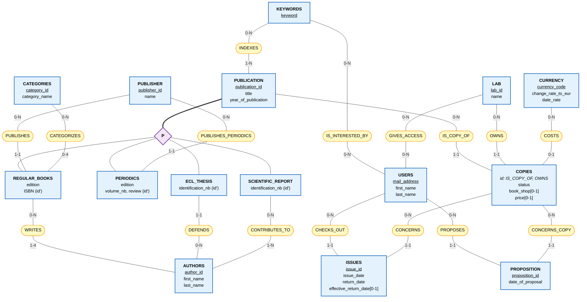

# Projet _Library Database_ — MOM 1.1 Systèmes de bases de données

Auteurs:

- DERGHAM Ouassim
- DORDENART Maxence

---

## Vue d'ensemble

Ce projet contient le travail réalisé dans le cadre du projet du MOM. Il contient notamment les schémas entité-association et relationnels, les requêtes d'ingestion de données et de questionnement de la base, le code de construction de la base de données et le code de conception de l'interface utilisateur.

Le sujet choisi est le **Sujet 2: _Library Database_**.

Le SGBD utilisé est **MySQL**.

## Prérequis

Les outils suivants doivent être installés sur la machine :

- **Git**
- **Docker Desktop** (lancé et actif en arrière-plan)
- **uv** (gestionnaire d'environnements et de paquets Python)

---

## Installation et initialisation

### 1. Cloner le dépôt

```bash
git clone https://github.com/moons-of-iego/Library-Database.git
```

### 2. Configurer les variables d'environnement

Dupliquer le fichier modèle `.env.example` pour créer un fichier local `.env` (ignoré par Git).  
Ouvrir ensuite `.env` et renseigner les mots de passe pour le projet (`DB_PASSWORD` et `DB_ROOT_PASSWORD`).

### 3. Installer l'environnement Python avec `uv`

Synchroniser l'environnement virtuel `.venv` et installer toutes les dépendances définies dans `uv.lock` :

```bash
uv sync
```

### 4. Démarrer la base de données MySQL avec Docker

Vérifier que **Docker Desktop** est bien ouvert, puis lancer le conteneur en arrière-plan :

```bash
docker compose up -d
```

Lors du premier démarrage, Docker crée automatiquement la base de données et exécute les scripts SQL présents dans le dossier `sql/`.

### 5. Vérification de l'installation

Lancer la suite de tests avec `pytest` pour vérifier que Python parvient à se connecter au conteneur MySQL :

```bash
uv run pytest -o log_cli=true --log-cli-level=INFO
```

Si le test passe au vert (`1 passed`), l'environnement est prêt.

---

### Commandes utiles

- **Arrêter la base de données (en conservant les données) :**
  ```bash
  docker compose stop
  ```
- **Relancer la base de données existante :**
  ```bash
  docker compose up -d
  ```
- **Réinitialiser complètement la base (supprime les données et rejoue `sql/`) :**
  ```bash
  docker compose down -v
  docker compose up -d
  ```

## Schémas de conceptions

### 1. Schéma entité-association



## 2. Schéma relationnel

```mermaid
erDiagram
    PUBLICATION {
        numeric publication_id PK
        varchar title
        numeric year_of_publication
    }

    REGULAR_BOOKS {
        numeric publication_id PK, FK
        varchar edition
        varchar ISBN UK
        numeric publisher_id FK
    }

    PERIODICS {
        numeric publication_id PK, FK
        varchar edition
        varchar volume_nb UK
        varchar review UK
        numeric publisher_id FK
    }

    ECL_THESIS {
        numeric publication_id PK, FK
        varchar identification_nb UK
        numeric author_id FK
    }

    SCIENTIFIC_REPORT {
        numeric publication_id PK, FK
        varchar identification_nb UK
    }

    PUBLISHER {
        numeric publisher_id PK
        varchar name
    }

    CATEGORIES {
        char category_id PK
        varchar category_name
    }

    CATEGORIZES {
        char category_id PK, FK
        numeric publication_id PK, FK
    }

    AUTHORS {
        numeric author_id PK
        varchar first_name
        varchar last_name
    }

    WRITES {
        numeric publication_id PK, FK
        numeric author_id PK, FK
    }

    CONTRIBUTES_TO {
        numeric publication_id PK, FK
        numeric author_id PK, FK
    }

    KEYWORDS {
        varchar keyword PK
    }

    INDEXES {
        varchar keyword PK, FK
        numeric publication_id PK, FK
    }

    COPIES {
        numeric publication_id PK, FK
        numeric lab_id PK, FK
        varchar status
        varchar book_shop
        numeric price
        varchar currency_code FK
    }

    CURRENCY {
        varchar currency_code PK
        numeric change_rate_to_eur
        date date_rate
    }

    LAB {
        numeric lab_id PK
        varchar name
    }

    USERS {
        varchar mail_address PK
        varchar first_name
        varchar last_name
    }

    GIVES_ACCESS {
        numeric lab_id PK, FK
        varchar mail_address PK, FK
    }

    IS_INTERESTED_BY {
        varchar keyword PK, FK
        varchar mail_address PK, FK
    }

    ISSUES {
        numeric issue_id PK
        date issue_date
        date return_date
        date effective_return_date
        numeric publication_id FK
        numeric lab_id FK
        varchar mail_address FK
    }

    PROPOSITION {
        numeric proposition_id PK
        date date_of_proposal
        varchar mail_address FK
        numeric publication_id FK
        numeric lab_id FK
    }

    PUBLICATION ||--o| REGULAR_BOOKS : "hérite"
    PUBLICATION ||--o| PERIODICS : "hérite"
    PUBLICATION ||--o| ECL_THESIS : "hérite"
    PUBLICATION ||--o| SCIENTIFIC_REPORT : "hérite"

    PUBLISHER ||--o{ REGULAR_BOOKS : "publishes"
    PUBLISHER ||--o{ PERIODICS : "publishes"

    CATEGORIES ||--o{ CATEGORIZES : ""
    REGULAR_BOOKS ||--o{ CATEGORIZES : ""

    REGULAR_BOOKS ||--|{ WRITES : ""
    AUTHORS ||--o{ WRITES : ""

    AUTHORS ||--o{ ECL_THESIS : "defends"

    SCIENTIFIC_REPORT ||--|{ CONTRIBUTES_TO : ""
    AUTHORS ||--o{ CONTRIBUTES_TO : ""

    KEYWORDS ||--o{ INDEXES : ""
    PUBLICATION ||--|{ INDEXES : ""

    KEYWORDS ||--o{ IS_INTERESTED_BY : ""
    USERS ||--o{ IS_INTERESTED_BY : ""

    PUBLICATION ||--o{ COPIES : "is_copy_of"
    LAB ||--o{ COPIES : "owns"
    CURRENCY ||--o{ COPIES : "costs"

    LAB ||--o{ GIVES_ACCESS : ""
    USERS ||--o{ GIVES_ACCESS : ""

    COPIES ||--o{ ISSUES : "concerns"
    USERS ||--o{ ISSUES : "checks_out"

    COPIES ||--o{ PROPOSITION : "concerns_copy"
    USERS ||--o{ PROPOSITION : "proposes"
```


